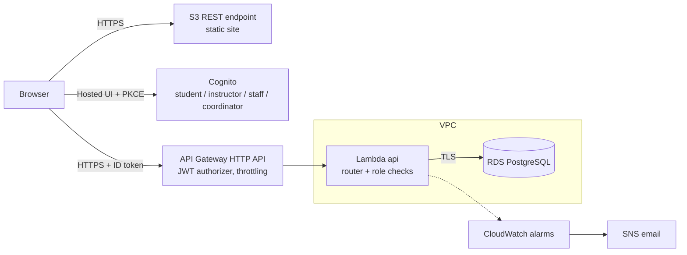

# Group12-CS361-Project

Curriculum Information & Graduation Verification System — CS361 Cloud-based Software Architecting, Thammasat University (Group 12).

The system lets anyone browse the Computer Science curricula, study plans, courses, prerequisites and graduation conditions, and ask questions. Signed-in students check whether they can graduate from the registrar's data; instructors and staff check their students; staff import registrar data; curriculum coordinators edit study plans with a full change history.

Current version: **V4** — graduation verification from registrar data, external data exchange, scale & availability.

## Repository map

| Path | Contents |
|---|---|
| `frontend/` | Static site (HTML, CSS, ES modules). `config.js` holds the API URL and Cognito settings |
| `backend/` | One AWS Lambda (TypeScript): `src/functions/api.ts` router, `src/domain/` audit engine and CSV parser, `src/providers/` SQL, `test/`, `dev/server.ts` local server |
| `db/` | `schema_v3.sql`, `seed_curricula.sql`, `migration_v4.sql`, `seed_v4_requirements.sql`, `seed_v4_faq.sql`, `sample-registrar/` synthetic CSV files, `local/apply-all.sh` |
| `document/context/` | Course brief, requirements PDFs, curriculum document (มคอ.2 2566), `context.md` summary |
| `document/v4/` | Architecture + ADRs, code review, registrar CSV contract, user-testing plan |
| `document/v5/`–`v7/` | Architecture designs for later versions |
| `document/er/` | ER diagram V1–V7 |
| `document/plan/issues-v4-v7.md` | All V4–V7 issues with Definition of Done |
| `document/deploy/` | Learner Lab deploy guide, local testing guide |
| `docker-compose.yml` | Local PostgreSQL |

## Architecture (V4)



Details and the twelve architecture decisions: [`document/v4/architecture-v4.md`](document/v4/architecture-v4.md).

## Run locally (no AWS credit)

```bash
docker compose up -d db
docker compose exec db sh /db/local/apply-all.sh
cd backend
npm ci
npm test
npm run dev
```

Open http://localhost:3001/index.html, sign in as one of the sample users on `login.html`, and import `db/sample-registrar/registrar_2569-1.csv` as staff. Full guide: [`document/deploy/local-testing.md`](document/deploy/local-testing.md).

## Deploy (AWS Academy Learner Lab)

```bash
cd backend
npm run package
```

Then follow [`document/deploy/deploy-learner-lab.md`](document/deploy/deploy-learner-lab.md): S3 over HTTPS → RDS → schema and seeds → Lambda in the VPC (LabRole) → Cognito groups and app client → HTTP API with JWT authorizer → alarms → `config.js` and upload.

## API

| Method and path | Access | Purpose |
|---|---|---|
| `GET /health` | public | API and database status |
| `GET /courses`, `GET /courses/{id}`, `GET /curricula` | public | catalogue |
| `GET /curriculum/{curriculumId}` (`/electives`, `/requirements`) | public | study plan, elective groups, graduation conditions |
| `GET /qa/search?q=`, `POST /qa/questions` | public | Q&A |
| `GET /me` | signed in | identity and roles |
| `GET /graduation/me` | student | own graduation audit |
| `GET /graduation/students`, `GET /graduation/students/{studentCode}` | instructor (advisees), staff (all) | students' audits |
| `POST /registrar/imports`, `GET /registrar/imports` | staff | registrar CSV import and history |
| `POST`, `PUT`, `DELETE /curriculum/{curriculumId}/entries` | coordinator | edit study plans (optimistic locking) |
| `GET /audit/curriculum-changes` | coordinator, staff | change history |

`{curriculumId}` accepts the UUID or the code (`applied-cs`, `cis-cs`, `cnc`).

## Versions

| Version | Scope |
|---|---|
| V1 | Problem, actors, system boundary; static pages |
| V2 | Curriculum database and public read API |
| V3 | Sign-in with Cognito, role-based pages, curriculum editing prototype |
| **V4** | Graduation verification from registrar data, CSV exchange, availability under missing data, audit trail, Q&A |
| V5 | Infrastructure as code (SAM), private database, automated deploy — [design](document/v5/architecture-v5.md) |
| V6 | Performance and cost measurement and tuning — [design](document/v6/architecture-v6.md) |
| V7 | Usage statistics (FR9), Q&A workflow, security and recovery review — [design](document/v7/architecture-v7.md) |

## Project vision (from V1)

Users find it hard to get accurate, current information about curricula, study plans, courses, prerequisites and graduation requirements because it is scattered across department documents, announcements and informal advice. The system is the single source for that information, and grows into graduation verification against real registrar data and controlled curriculum management by authorised staff.

Primary users: prospective and current students, instructors, programme staff, curriculum coordinators, visitors.
